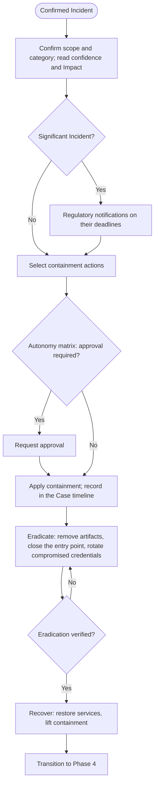

# Phase 3: Incident Response

A Case enters this phase when [Phase 2: Detection & Analysis](02-detection_and_analysis.md) has proven the Malicious hypothesis and confirmed the Case as an **Incident** (`verdict_id = 2`). Incident Response contains the threat, eradicates it and restores operations. It is aligned to NIST SP 800-61 Rev. 3 (Table 3, Respond and Recover) and ISO/IEC 27035 (Respond).

The Case [assignee](../01-Foundation/definitions.md#6-executors-and-functions) carries the Incident through this phase: the framework has no separate response function or incident commander, and every step below is executable by a human analyst, deterministic automation or an agent alike. What differs by executor is not the process but the **approval** some actions require (§2.1), which the [Agentic Guardrails](../07-Governance/agentic_guardrails.md) govern.

## Inputs & Outputs

| | |
|---|---|
| **Consumes** | A **Confirmed Incident** with its Investigation → Response [phase transition contract](../01-Foundation/definitions.md#phase-transition-contract): confirmed Incident Category, scope (affected entities), timeline with T0, severity, confidence, impact, the significance and cross-border flags, and the planned response actions (field schema in [Playbook Architecture §5](../04-Playbooks/playbook_architecture.md#5-phase-transition-contracts)). |
| **Produces** | A contained, eradicated and recovered environment (services restored, containment lifted); every response action appended to the Case timeline ([Case Schema](../02-Taxonomy/case_schema.md)); the regulatory notifications the Incident requires (§6); and the transition to [Phase 4: Post-Incident Activity](04-post_incident_activity.md) (§5). |

## Process Flowchart

## 1. Scope Confirmation

The Incident arrives confirmed; this step confirms what the response acts on. From the phase transition contract, the executor:

1. Confirms the **scope**: the affected entities (identities, assets, network locations, artifacts) and the confirmed [Incident Category](../02-Taxonomy/incident_categories.md), whose Investigation & Response playbook lists the containment, eradication and recovery actions for that kind of Incident.
2. Reads the Case **confidence**, as the resolution rule produced it ([Detection & Analysis §2.4](02-detection_and_analysis.md#24-hypothesis-resolution-verdict-and-confidence)), and the Incident's **Impact**, as assessed at confirmation ([§2.5](02-detection_and_analysis.md#25-incident-confirmation)): with the impact of each action, they decide which containment actions are applied without approval (§2.1).
3. Reads what each affected identity is. It is a **person's account**; a **service identity**, an account or service principal that software runs under; or a **host's own identity**, the computer account a directory gives a joined device or one of the operating system's built-in principals such as `SYSTEM` or `NETWORK SERVICE`, which OCSF types as a User of type System. An identity action (suspending sessions, disabling the account, resetting its credentials) is selected for a person's account or a service identity that the Case shows was used or exposed by the threat. A host's own identity appears in the scope because something ran under it on that host, and it is contained through the host (§2.1): no identity action is selected on it.
4. Reads the kind and the requirements recorded for each affected entity ([critical entity](../01-Foundation/definitions.md#critical-entity)): they rate the actions on it (§2.1).

Scope expands during the response as containment and eradication reveal further affected entities: every expansion is recorded on the Case, a technique it reveals joins the Case's tactics and techniques, and the containment actions are re-selected for the new entities.

## 2. Containment

Containment stops the threat from causing further damage while the Incident is eradicated. The executor starts from the containment actions planned at confirmation ([Detection & Analysis §2.5](02-detection_and_analysis.md#25-incident-confirmation)), selects further ones from the playbook of the confirmed Incident Category as the scope expands, and applies them under the autonomy matrix below. Every containment action is recorded in the Case timeline with its timestamp, the entity it acted on and how it is reversed.

**An identity is contained where it is held.** An account may be held by a cloud identity provider, by an on-premises directory, by both (an on-premises account synchronized to the cloud identity provider), or by a single host (a local account). An identity action applies to the copy held where the action is taken, and to nothing else:

*   Disabling the synchronized cloud copy of an on-premises account leaves the account signing in against the on-premises directory, and the next synchronization may enable the copy again. The account is disabled in the directory that manages it, and its synchronized copy is disabled as well.
*   Suspending sessions ends the sessions the issuing system granted: ending the cloud sessions leaves the sign-ins the on-premises directory granted, which end when the account is disabled there and its open sign-ins on hosts are ended.
*   A credential reset is made where the credential is managed.
*   A local account is disabled, and its open sign-ins ended, on the host that holds it; no directory reaches it.

The executor applies the action in each place that holds the identity and records each one.

**An action the executor cannot apply is handed to a person.** Where no means the executor holds reaches the place an entity is held (an on-premises directory, a host's local accounts), the executor hands the action to a person as a task stating the steps, and the person applies it. Handing it over does not change its place in the matrix below: an action that requires approval is approved before anyone applies it. Its entry in the Case timeline names who applied it.

> **Example — a synchronized account.** A confirmed credential-theft Incident: an account managed in the on-premises directory and synchronized to the cloud identity provider signed in from an unfamiliar country, then to a file server. The executor acts through the cloud identity provider only. It suspends the account's cloud sessions and disables the cloud copy, and hands a person the rest: disable the account in the on-premises directory, reset its password there, end its sign-ins on the file server. The Case timeline records each action, the last three under the name of the person who applied them.

### 2.1 Risk-Based Autonomy Matrix for Containment

The matrix decides, for each containment action, whether the executor applies it directly or requests approval first. It is the single authority on containment autonomy in the framework.

**It reads three inputs, and none is the executor's own estimate:** the Case **confidence**, as the resolution rule produced it ([Detection & Analysis §2.4](02-detection_and_analysis.md#24-hypothesis-resolution-verdict-and-confidence)); the Incident's **Impact**, as assessed at confirmation ([§2.5](02-detection_and_analysis.md#25-incident-confirmation)); and the **impact of the action**, what the organization cannot use while the action holds, read from the classes below and from what the records say of the entity it acts on ([critical entity](../01-Foundation/definitions.md#critical-entity)).

| The action's impact | What the organization cannot use | Examples |
|---|---|---|
| **None** | Nothing, even if the Incident proves false | Blocking an address or domain no entity of the organization uses; disabling or removing a rule, token, consent or account the records show the threat actor created, such as a mail rule that still forwards data out |
| **Low** | The service of one person or of one end-user device | Isolating an end-user workstation; disabling a person's account or ending its sessions; quarantining a file or a message, which is someone's own if the Incident is false |
| **Medium** | A non-critical service, or the service of a group of people | Isolating a server no critical service depends on; disabling a service identity no critical service runs under; cutting a connection to a third party that only occasional work depends on |
| **High** | A critical service | Stopping an availability-critical entity; cutting a connection to a third party that operations depend on |
| **Critical** | A network segment, many entities in one action, or a service the whole organization depends on | Isolating a subnet or a cloud network; disabling many identities at once; stopping the directory service |

An action is rated by what the organization would lose, whoever owns the target: cutting the connection of a compromised third party is rated by what runs over it. An entity the records do not show to be an end-user device or a person's account, and whose availability requirement is not recorded, is rated High. The side effects of an action are part of its impact. Each action is rated on its own target, and reversing one is itself an action the matrix rates. A safety function is never stopped without approval. A host's own identity is never disabled: every service of the host runs under it, and disabling it takes the host off its directory. The host is contained by isolating it.

**The matrix.** Each cell gives the Case confidence at which the action is applied without approval. Below that confidence, and where the cell says so, the executor requests approval.

| The action's impact ↓ / the Incident's Impact → | Low | Medium | High | Critical |
|---|---|---|---|---|
| **None** | Low or above | Low or above | Low or above | Low or above |
| **Low** | requires approval | Medium or above | Medium or above | Low or above |
| **Medium** | requires approval | High | High | Medium or above |
| **High** | requires approval | requires approval | High | Medium or above |
| **Critical** | requires approval | requires approval | requires approval | High |

The matrix binds every executor. A person applies without approval what it allows. Automation and agents do so within their autonomy grant ([Agentic Supervision §4](../07-Governance/agentic_supervision.md#4-autonomy-grant)), and with no grant they request approval for every action. An organization may add approvals and remove none: stricter cells, a grant limited to actions up to a given impact, by action or by time window, and classes of entities reserved in the [SOC Knowledge Base](../01-Foundation/definitions.md#soc-knowledge-base-soc-kb), such as its VIPs or its availability-critical entities, on which every containment action requires approval.

**Approval** is requested with the payload below; once the action has run, its entry in the Case timeline names who approved it ([Case Schema §5](../02-Taxonomy/case_schema.md)). An action is requested only on an entity of the kind it acts on (§1): disabling an account is never requested on a host's own identity. The approver decides whether to act; whether the action can apply to the entity is settled before the request. The payload is what the approver decides on; the decision — approved, modified, rejected — is recorded in the Case timeline, and a rejection is an overturn source for [Operational Metrics §5.4](../05-Metrics/operational_metrics.md).

1.  **Context:** the Incident Category, the Case severity and confidence, the Incident's Impact, and in plain language why the Malicious hypothesis was proven — the score and the observations that carry it ([Detection & Analysis §2.4](02-detection_and_analysis.md#24-hypothesis-resolution-verdict-and-confidence)).
2.  **Evidence:** the observations, each with its tag and the event references and queries behind it.
3.  **The action and its matrix entry:** what will be done, to which entity and what that entity is (for an identity: a person's account or a service identity), and the reason the matrix gives for requiring approval: the action's impact, the Incident's Impact and the confidence, the proportionality condition, a limit of the grant, or the reserved class.
4.  **Blast radius:** the expected effect on operations, e.g., "disconnects the primary database server; the customer portal is unavailable until reconnected".
5.  **Rollback:** the exact call, script or procedure that reverses the action, or the statement that it cannot be reversed.

The approver is an organization policy knob that follows the action's impact, e.g.: the owner of the service for High, the organization's crisis authority for Critical. The wait is measured as dwell time ([Operational Metrics §4](../05-Metrics/operational_metrics.md)). While approval is pending the executor applies what the matrix allows and continues the investigation.

> **Example — an administrator's account and a domain controller.** A credential-theft Incident at High confidence and High Impact: an administrator's account authenticated to a domain controller from a host it never used. Disabling the account and ending its sessions are actions of Low impact, since it is a person's account and no service runs under it. That cell asks for Medium confidence, so the executor applies them. Isolating the domain controller stops the directory service, an action of Critical impact, which at High Impact requires approval.
>
> **Example — Low confidence.** A new access key on a developer's cloud account, created outside change windows and used from an unfamiliar region: an Incident at Low confidence and Medium Impact. If the Incident is false the key is the developer's own, so revoking it is an action of Low impact. That cell asks for Medium confidence, and the executor requests approval. A further Observation, the key downloading a storage bucket, raises the confidence to Medium, and the key is revoked without approval.
>
> **Example — ransomware on a critical server.** Ransomware is encrypting an availability-critical file server: an Incident at High confidence and High Impact. Isolating the server is an action of High impact, and that cell asks for High confidence. The executor isolates it at once; one whose grant stops at actions of Low impact requests approval.

---

## 3. Eradication

Eradication removes the threat actor and every foothold from the environment. An eradication or recovery action that destroys what the organization holds requires approval, requested as §2.1 states. The executor:

*   **Verifies containment first:** confirms, from the telemetry of the affected entities, that the contained activity has stopped — no lateral movement from the isolated hosts, no traffic to the blocked command-and-control infrastructure, no successful authentication by the disabled identities. Containment that has not held is corrected before eradication starts.
*   **Removes artifacts and persistence:** deletes malicious files and scripts, terminates rogue processes, and removes the persistence mechanisms the timeline identified (scheduled tasks, registry entries, services, web shells, mailbox rules, added credentials or OAuth grants).
*   **Closes the entry point:** patches the exploited vulnerability or corrects the configuration that allowed the initial access, so that the same path cannot be reused before recovery.
*   **Rotates compromised credentials:** resets the credentials of the identities the Case timeline confirms as compromised or exposed, and of the secrets those identities could reach. A reset broader than the confirmed scope requires approval.

Each eradication action is recorded in the Case timeline; a foothold found during eradication that the investigation had not identified expands the scope (§1). Eradication is verified (G5) when every action is confirmed and no foothold is left.

---

## 4. Recovery

Recovery restores operations to a verified clean state:

*   **Verification:** monitoring of the affected entities shows no indicator of compromise for a defined window (24 hours of normal operation as the reference value; an organization policy knob) before containment is lifted.
*   **System restoration:** systems are re-imaged from known-good templates or restored from verified backups taken before T0; restored data is checked for the artifacts eradicated in §3.
*   **Lifting containment:** egress blocks, network isolation and identity suspensions are removed gradually, each removal recorded in the Case timeline, with the detections that fired for the Incident kept active on the restored entities.

---

## 5. Transition to Phase 4

The response ends when containment has been lifted and the affected services are restored: recovery is complete (G6), and the Case's status is set to Resolved. The Case, with its timeline of detection and response actions, its Notes and its metrics (T0, MTTD, MTTC, MTTR per [Operational Metrics §4](../05-Metrics/operational_metrics.md)), is what [Phase 4: Post-Incident Activity](04-post_incident_activity.md) consumes. The framework does not yet define a separate Incident Record deliverable: the Case as the [Case Schema](../02-Taxonomy/case_schema.md) defines it, together with the Investigation Note, is the record of the Incident.

---

## 6. Regulatory Reporting (NIS2 & DORA)

Regulatory reporting applies when the Incident is **significant** and the organization is in scope of the regulation. Whether the Incident is significant, and whether it has cross-border effect, is assessed at confirmation ([Detection & Analysis §3.1](02-detection_and_analysis.md#31-incident-promotion)) and recorded in the Case (`significant`, `cross_border`); the notification is triggered there ([§3.2](02-detection_and_analysis.md#32-stakeholder--regulatory-notification)) and owned by the SOC Manager. This section specifies the reports. Deadlines run from the moment the organization becomes aware of the Incident, which is at the latest its confirmation; the response does not wait for a report, and a report does not wait for the response to end.

The recipient is the national CSIRT or the competent authority the regulation designates; the reporting channel and the legal review of each report are organization policy.

### 6.1 NIS2 (Article 23)

*   **Early warning, within 24 hours:** whether the Incident is suspected to be caused by unlawful or malicious acts, and whether it could have cross-border effect. It states what is known at the time; it is not an assessment.
*   **Incident notification, within 72 hours:** an update of the early warning with the initial assessment of the Incident's severity and impact, and the indicators of compromise available.
*   **Intermediate report, on request:** a status update when the competent authority or the CSIRT asks for one.
*   **Final report, within one month of the incident notification:** a detailed description of the Incident, its severity and impact, the type of threat or root cause that likely triggered it, the mitigation applied and, where applicable, the cross-border impact. When the Incident is still ongoing at that time, a progress report is submitted instead and the final report follows within one month of the Incident being handled.

### 6.2 DORA (Article 19)

For financial entities, a **major** ICT-related Incident (classified per the criteria of Article 18, recorded in the Case as `significant`) is reported in three steps, on the deadlines the regulation and its technical standards set:

*   **Initial notification:** the classification of the Incident as major and its known characteristics, within the hours of classification the standards specify.
*   **Intermediate report:** the status of the Incident and the changes since the initial notification, and whenever the status changes materially.
*   **Final report:** the root cause analysis and the actions taken, once the Incident is handled.

The reports draw on the Case: the timeline and T0, the affected entities and their criticality, the impact and its assessment, and the containment, eradication and recovery actions recorded in this phase.
